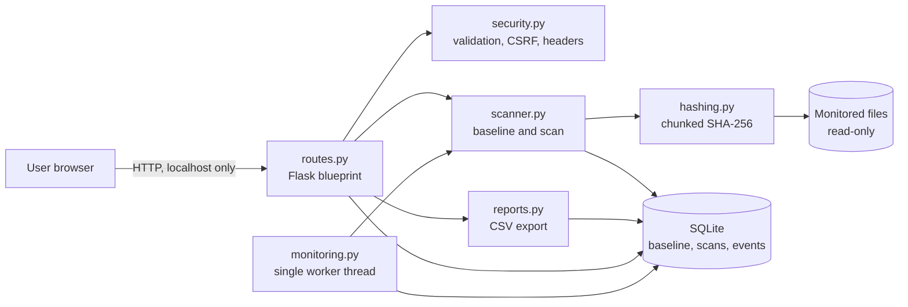
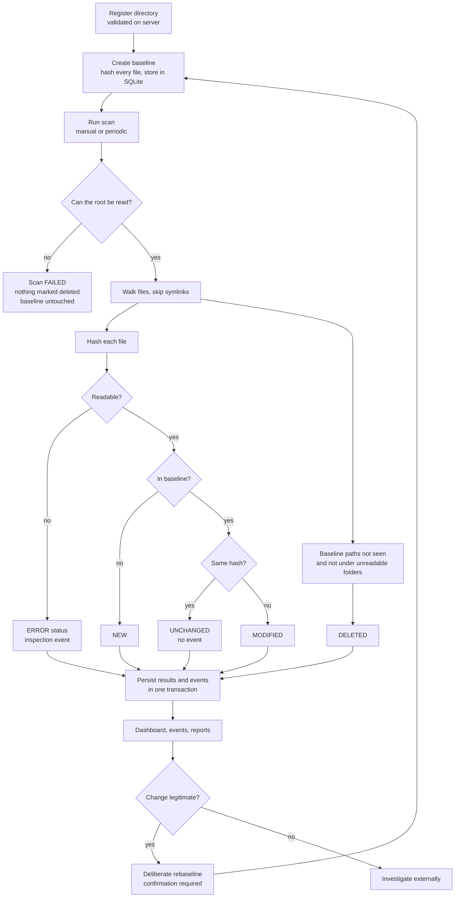

# Implementation of File Integrity Monitoring Using Python

**Author:** Anand D  
**Course:** 24CSA535 — Web Application Security  
**Project type:** Security-focused academic mini-project  
**Version:** 1.0.0

> **Honest status note (read first).** This project was built and exercised in a sandbox where PyPI and npm were blocked by network policy. Consequences, all stated plainly:
>
> * `pytest` and `Flask-WTF` could not be installed. CSRF protection is therefore a small, session-bound token implementation inside `fim/security.py` (the brief allows "an equivalent solution"). The test files are ordinary pytest files, but the **83 tests were executed with a tiny stand-in runner, not real pytest** (details in [section 34](#34-automated-testing-instructions-and-verified-results)). Please run `python -m pytest -v` on your machine and treat that as the authoritative result.
> * Bootstrap 5, Bootstrap Icons and Chart.js could not be downloaded, so the interface uses its own CSS, inline SVG icons and a small canvas chart. This also lets the Content Security Policy be strictly `'self'` with no CDN.

---

## Table of contents

1. [Project title](#1-project-title) · 2. [Author and course](#2-author-and-course-information) · 3. [Abstract](#3-abstract) · 4. [Introduction](#4-introduction) · 5. [Problem statement](#5-problem-statement) · 6. [Objectives](#6-objectives) · 7. [Scope](#7-scope) · 8. [Importance](#8-importance-of-file-integrity-monitoring-in-web-application-security) · 9. [Existing vs proposed](#9-existing-approach-and-proposed-solution) · 10. [Functional requirements](#10-functional-requirements) · 11. [Non-functional requirements](#11-non-functional-requirements) · 12–14. [Architecture and diagrams](#12-system-architecture) · 15. [Stack](#15-technology-stack-and-justification) · 16. [Folder structure](#16-complete-folder-structure-and-file-explanations) · 17. [SHA-256](#17-explanation-of-sha-256) · 18. [Baseline](#18-baseline-creation-and-storage) · 19. [Detection algorithm](#19-file-change-detection-algorithm) · 20. [Event logging](#20-security-event-logging) · 21. [Schema](#21-database-schema) · 22–27. [Security controls](#22-web-application-security-controls) · 28–30. [Install and run](#28-installation-instructions) · 31. [Pages](#31-explanation-of-every-application-page) · 32. [Demonstration](#32-step-by-step-demonstration-instructions) · 33. [Sample output](#33-sample-expected-outputs) · 34. [Tests](#34-automated-testing-instructions-and-verified-results) · 35. [Methodology](#35-security-testing-methodology) · 36. [Limitations](#36-limitations-and-known-risks) · 37. [Future work](#37-future-enhancements) · 38. [Troubleshooting](#38-troubleshooting) · 39. [FAQ](#39-frequently-asked-questions) · 40. [Conclusion](#40-conclusion) · 41. [References](#41-references)

---

## 1. Project title

**Implementation of File Integrity Monitoring Using Python** — a local Flask web application that records trusted SHA-256 fingerprints of selected files and reports when files are modified, added or deleted.

## 2. Author and course information

| Field | Value |
|---|---|
| Author | Anand D |
| Course code | 24CSA535 |
| Course name | Web Application Security |

## 3. Abstract

Web applications are made of files: source code, configuration, templates and static assets. If an attacker (or a mistake) changes one of these files, the application's behaviour changes, often invisibly. This project implements **file integrity monitoring (FIM)**: a trusted *baseline* of SHA-256 hashes is stored in SQLite, and later scans compare the current files with it, classifying each as `UNCHANGED`, `MODIFIED`, `NEW`, `DELETED` or `ERROR`. The tool is itself a web application, so it also demonstrates secure web development: server-side input validation, path-traversal containment, parameterised SQL, output escaping with a strict Content Security Policy, CSRF tokens, safe error handling and CSV formula-injection protection. A detected change is treated as an *indicator to investigate*, never as proof of malice.

## 4. Introduction

A cryptographic hash function maps any file to a short fixed-size fingerprint. Change one byte of the file and the fingerprint changes completely. FIM uses that property: record fingerprints while the system is in a known-good state, and re-check later. Commercial and open-source tools (for example OSSEC/Wazuh, AIDE, Tripwire) do this at scale; this project implements the core idea in a small, readable form suitable for study.

## 5. Problem statement

Unauthorised or unexpected file changes are a common sign of compromise (web shells, injected scripts, altered configuration), and also a common result of honest mistakes during deployment. Administrators who cannot cheaply tell *what changed since the last known-good state* discover problems late. The problem solved here: provide a simple, safe, local tool that detects such changes in an explicitly chosen set of directories and records them for review, without over-claiming what a change means.

## 6. Objectives

1. Compute reliable SHA-256 fingerprints of files without loading them fully into memory.
2. Store a trusted baseline and compare later states against it.
3. Classify differences as unchanged, modified, new, deleted or error, and never mistake an unreadable file for a deleted one.
4. Record meaningful events and scan history without alert spam.
5. Present results in a clear security dashboard and exportable CSV reports.
6. Implement the tool itself securely (input validation, path-traversal, SQL-injection, XSS and CSRF defences) and test those defences.
7. Document the design, limitations and honest threat model.

## 7. Scope

**In scope (implemented):** local single-user web UI; directory registration with validation; baseline / rebaseline; manual and optional periodic scans; event log; scan history; file inventory; CSV reports; settings; automated tests; this documentation.

**Out of scope:** multi-user authentication, remote agents, real-time kernel-level file watching, preventing changes, malware detection, scanning the whole operating system, tamper-proof logging. See [section 36](#36-limitations-and-known-risks) and [section 37](#37-future-enhancements).

## 8. Importance of file integrity monitoring in web application security

| Threat | How FIM helps | What FIM cannot tell you |
|---|---|---|
| Unauthorised source-code modification (web shell, backdoor) | A source file becomes `MODIFIED` or a `NEW` file appears | Who did it or why |
| Configuration tampering | `config.ini` hash differs from baseline | Whether the new setting is malicious |
| Tampered static assets (e.g. a script skimmer appended to `site.js`) | Asset hash changes | What the injected code does |
| Suspicious additions to a directory | `NEW` status | Whether the file is harmful |
| Deleted important files | `DELETED` status | Whether deletion was intended |
| Accidental deployment mistakes | Unexpected `MODIFIED` after a release | — |

These are **indicators of possible incidents, not proof of an attack.** The dashboard words every warning that way, and nothing is ever labelled "malware".

## 9. Existing approach and proposed solution

*Existing approaches:* manual `diff`/`sha256sum` comparisons, version-control status (only covers tracked files and trusts the working copy), and host-based tools such as AIDE, Tripwire or OSSEC/Wazuh (powerful but heavyweight to configure and explain).

*Proposed solution:* a lightweight Python/Flask application that (a) hashes with the standard library, (b) stores baselines in SQLite, (c) gives a dashboard for review, and (d) is deliberately conservative: scans never overwrite the baseline, failures never masquerade as deletions, and every user input is validated on the server.

## 10. Functional requirements

| ID | Requirement | Implemented in |
|---|---|---|
| F1 | Dashboard with real database metrics | `routes.dashboard`, `dashboard.html` |
| F2 | Register / remove directories with validation and confirmation | `security.validate_directory_input`, `routes.add_directory/remove_directory` |
| F3 | Chunked SHA-256 hashing service | `fim/hashing.py` |
| F4 | Baseline creation and deliberate rebaselining | `scanner.create_baseline` |
| F5 | Change detection with 5 statuses | `scanner.run_scan` |
| F6 | Searchable, filterable, paginated event log | `routes.events` |
| F7 | Explanation of monitored file categories | `monitored_paths.html` |
| F8 | Optional periodic scanning (single worker) | `fim/monitoring.py` |
| F9 | CSV reports with formula-injection protection | `fim/reports.py` |
| F10 | Validated settings page | `routes.settings/update_settings` |

## 11. Non-functional requirements

* **Security:** see sections 22–27. **Privacy:** file contents never leave the machine and are never stored; only hashes, sizes and timestamps.
* **Reliability:** scans are serialised; database changes use transactions; failures are recorded, not hidden.
* **Performance:** files are hashed in 1 MiB chunks; configurable file-count and file-size limits.
* **Usability:** responsive layout, keyboard-accessible controls, visible focus, text labels in addition to colours, empty/loading/error states.
* **Maintainability:** one module per responsibility; small, tested functions.
* **Portability:** Python 3.11+, Windows/Linux/macOS, no compiled dependencies.

## 12. System architecture

The browser talks only to a Flask process bound to `127.0.0.1`. Flask routes validate input, call the scanner/report modules, and read/write SQLite. A single optional background worker thread (started once by the application factory) runs periodic scans through the same scanner code and lock.

```
Browser ──HTTP──▶ Flask (routes.py) ──▶ security.py (validation, CSRF, headers)
                       │                     │
                       ├──▶ scanner.py ──▶ hashing.py ──▶ monitored files (read-only)
                       ├──▶ reports.py
                       └──▶ database.py ──▶ SQLite (data/fim.sqlite3)
monitoring.py (1 worker thread) ──▶ scanner.py (shared lock)
```

## 13. Architecture diagram



## 14. File integrity monitoring workflow diagram



## 15. Technology stack and justification

| Component | Choice | Why |
|---|---|---|
| Language | Python 3.11+ | Readable, strong standard library |
| Web | Flask 3.1 (+ Jinja2, Werkzeug, itsdangerous) | Small, explicit, autoescaping templates |
| Database | SQLite (`sqlite3`) | Zero setup, transactions, foreign keys |
| Hashing | `hashlib.sha256` | Standard, audited implementation |
| Filesystem | `pathlib`, `os` | Safe path resolution and walking |
| Frontend | Hand-written HTML5/CSS3/JavaScript | No CDN, so the CSP can be `'self'` only (see honesty note) |
| CSRF | Session-bound token in `security.py` | Flask-WTF could not be installed here; same synchroniser-token pattern |
| Tests | pytest-style test files | Standard; see section 34 for what was actually run |

`requirements.txt` lists only `Flask==3.1.3`, the one third-party package the application imports. `requirements-dev.txt` adds `pytest`.

## 16. Complete folder structure and file explanations

```text
python-file-integrity-monitor/
├── app.py                 Entry point (debug and reloader off, binds localhost)
├── config.py              Settings from environment variables; secure defaults
├── requirements.txt       Runtime dependency (Flask)
├── requirements-dev.txt   Adds pytest
├── .env.example           Documented configuration names, no secrets
├── .gitignore             Ignores caches, venv, .env, databases, logs, exports
├── README.md              This document
├── fim/
│   ├── __init__.py        Application factory, error handlers, worker creation
│   ├── routes.py          All HTTP routes, filter/ID validation, authorisation helper
│   ├── database.py        Schema, connections, settings, event helper
│   ├── hashing.py         Chunked SHA-256 with error/instability detection
│   ├── scanner.py         Directory walk, baseline, scan and classification
│   ├── monitoring.py      Single background worker for periodic scans
│   ├── reports.py         CSV generation and formula-injection protection
│   └── security.py        Path validation, input parsing, CSRF, security headers
├── templates/             base, dashboard, monitored_paths, file_inventory,
│                          file_detail, events, scan_history, reports, settings,
│                          about, error, plus _macros.html (icons, badges, pager)
├── static/css/style.css   Dark security-operations theme
├── static/js/app.js       Nav toggle, toasts, confirm dialog, canvas chart
├── data/ logs/ exports/   Runtime folders (kept with .gitkeep)
├── sample_files/          Harmless demo files and instructions
└── tests/                 conftest, helpers, test_hashing/scanner/routes/security/reports
```

Differences from the suggested layout: `requirements-dev.txt`, `templates/file_detail.html`, `templates/_macros.html`, `tests/helpers.py` and one extra table (`scan_results`) were added. No `LICENSE` file is included: the licence is the author's decision and is **pending** (see [section 36](#36-limitations-and-known-risks)).

## 17. Explanation of SHA-256

SHA-256 turns any input into a 256-bit (64 hexadecimal character) digest. Properties that matter here:

* **Deterministic:** same bytes → same digest.
* **Avalanche effect:** changing one bit changes about half the output bits.
* **Preimage/collision resistance:** it is computationally infeasible to craft a different file with the same digest.

Example: the SHA-256 of the three bytes `abc` is `ba7816bf…15ad`; the hash of an empty file is `e3b0c442…b855` (both verified in `tests/test_hashing.py`).

**What a hash difference does and does not mean.** A changed digest means the file *contents differ from the baseline* (assuming the comparison was reliable). It does not say *who* changed the file, *when*, or whether the change is malicious. The hash covers contents only; permissions and ownership are not part of it.

The core loop (from `fim/hashing.py`): the file is opened read-only in binary mode and fed to the digest 1 MiB at a time, so memory use stays constant:

```python
with open(p, "rb") as handle:  # read-only, binary
    while True:
        chunk = handle.read(chunk_size)
        if not chunk:
            break
        digest.update(chunk)
        total += len(chunk)
```

Before and after reading, the file's size and modification time are compared; if they differ the result is a `HashError("UNSTABLE")` rather than a possibly inconsistent hash.

## 18. Baseline creation and storage

The baseline is the set of `(relative path, SHA-256, size, mtime, timestamp)` rows in table `file_baselines` for a directory.

1. Validate the directory, walk it (symlinks skipped), hash **every** file.
2. If *any* file cannot be read, the directory has too many files, or a subfolder cannot be listed, the operation is **aborted** and the existing baseline is left untouched. A partial baseline would silently trust an incomplete picture.
3. Otherwise, inside one `BEGIN IMMEDIATE … COMMIT` transaction: delete the old rows, insert the new rows, stamp the directory, and write a `BASELINE_CHANGE` event.
4. Creating a baseline when one exists is refused. Replacing it ("rebaseline") needs a separate action **and** a confirmation dialog **and** `confirm=yes` on the server. The audit event records how many files differed from the previous baseline.

Normal scans only read the baseline. A modified file stays `MODIFIED` on every later scan until a human decides otherwise.

**Trust limitation:** if an attacker can modify both the monitored files *and* `data/fim.sqlite3`, they can rewrite the baseline and hide their changes. The baseline is a trusted reference only as far as its storage and file permissions are trustworthy. See section 37 for stronger options.

## 19. File change detection algorithm

```text
function scan(directory):
    acquire SCAN_LOCK (non-blocking; if busy -> refuse, never overlap)
    baseline <- rows for directory (error if none)
    record scan row as RUNNING
    if root missing / symlink / unreadable:
        mark scan FAILED, add SCAN_FAILURE event, STOP   # no deletions inferred
    walk <- files below root (no symlinks), note unreadable subfolders, file-limit truncation
    for each file in walk:
        try hash it
        except HashError -> status ERROR (never DELETED)
        if path not in baseline        -> NEW
        else if hash == baseline hash  -> UNCHANGED
        else                           -> MODIFIED
    if walk was not truncated:
        for each baseline path not seen in walk:
            if it lies under an unreadable folder -> ERROR
            else                                  -> DELETED
    scan status <- PARTIAL if any ERROR / truncation / unreadable folder else COMPLETED
    in ONE transaction: save results, save events (skipping repeats), update scan row
    release lock
```

Excerpt of the classification (from `fim/scanner.py`):

```python
if base is None:
    status = "NEW"
elif base["sha256"] == h.sha256:
    status = "UNCHANGED"
else:
    status = "MODIFIED"
```

Why this is conservative: failures yield `ERROR`/`PARTIAL`/`FAILED`, never `DELETED`; the baseline is never written by a scan; and the whole result set commits atomically or not at all (any unexpected exception rolls back, marks the scan `FAILED`, and returns a generic message).

## 20. Security event logging

Event categories: `FILE_CHANGE` (with `MODIFIED` / `NEW` / `DELETED`), `INSPECTION_ERROR`, `SCAN_FAILURE`, `BASELINE_CHANGE`, `SERVICE_ERROR`. Each event stores ID, UTC timestamp, directory, relative path, category, previous hash, current hash, scan ID and a description.

**No alert spam:** `UNCHANGED` files never create events, and a finding identical to the previous scan's (same status and hash) is not repeated. If the file is changed *again* (new hash) or reverted and re-modified, a fresh event is written. The events page offers search, category/change/directory/scan filters, pagination (25 per page) and newest-first ordering. These logs are application audit records, **not tamper-proof evidence**.

## 21. Database schema

| Table | Purpose | Key constraints |
|---|---|---|
| `monitored_directories` | Registered roots (label, real path, category, timestamps) | `path UNIQUE` |
| `file_baselines` | Trusted hashes | FK → directories `ON DELETE CASCADE`, `UNIQUE(directory_id, rel_path)`, `CHECK(length(sha256)=64)` |
| `scan_history` | One row per scan with counts and completeness | `status IN ('RUNNING','COMPLETED','PARTIAL','FAILED')`, trigger `MANUAL/PERIODIC` |
| `scan_results` *(added)* | Per-file result of each scan (feeds inventory, reports, scan details) | FK → scan and directory, status `CHECK` |
| `security_events` | Audit events | category `CHECK`, FKs `ON DELETE SET NULL`, indexes on time and category |
| `application_settings` | Key/value settings (`periodic_enabled`, `scan_interval_seconds`) | `key PRIMARY KEY` |

Foreign keys are enforced (`PRAGMA foreign_keys = ON` on every connection), paths are stored **relative** to their root, the database is created automatically on first start, and every baseline change or scan commit is a single transaction.

## 22. Web application security controls

| Control | Where | Tested in |
|---|---|---|
| Server-side validation of paths, IDs, filters, pages, intervals | `security.py` `parse_*`, `validate_*` | `test_security.py`, `test_routes.py` |
| Path-traversal and symlink containment | `security.safe_join`, `validate_directory_input`, scanner walk | `test_security.py` |
| Parameterised SQL, allow-listed sort/filter, escaped `LIKE` | `routes.py`, `database.py` | `test_sql_injection_*` |
| Autoescaping, no `innerHTML`, no inline script/style, strict CSP | templates, `app.js`, `security.CSP` | `test_*xss*`, `test_templates_have_no_inline_*` |
| CSRF tokens on every POST; no state change via GET | `security.validate_csrf` | `test_csrf_*`, `test_state_changing_urls_reject_get` |
| Security headers, cookie flags, localhost bind, debug off | `security.apply_security_headers`, `config.py`, `app.py` | `test_security_headers_present` etc. |
| Safe errors (no stack traces, no secrets) | `fim/__init__.py` handlers | `test_error_pages_do_not_leak_details` |
| CSV formula-injection protection | `reports.sanitize_cell` | `test_reports.py` |
| Server-side authorisation of every directory ID | `routes.authorize_directory` | `test_directory_id_alone_is_not_authorisation` |

## 23. Path traversal prevention

Registration (`validate_directory_input`) rejects, in this order: empty or over-long input; control/NUL characters; any `..` segment, **including percent-encoded and double-encoded forms** (decoded up to three layers); relative paths; symlinks; nonexistent or non-directory paths; filesystem roots; unreadable directories; protected OS locations (`/etc`, `/proc`, `/sys`, `C:\Windows`, …); and the application's own data/log/export folders or any ancestor of them.

For paths *inside* a monitored root, `safe_join` proves containment before anything touches the disk:

```python
def safe_join(root, rel):
    rel_text = validate_relative_path(rel)          # no '..', not absolute, no NUL
    root_real = Path(root).resolve(strict=True)
    target = root_real.joinpath(*[p for p in re.split(r"[\\/]+", rel_text) if p])
    probe = root_real
    for part in target.relative_to(root_real).parts:
        probe = probe / part
        if probe.is_symlink():
            raise PathSecurityError("Symbolic links are not followed.")
    resolved = target.resolve(strict=False)
    if not _is_within(resolved, root_real):
        raise PathSecurityError("Path escapes the monitored directory.")
    return resolved
```

The scanner never follows symlinks (`os.walk(followlinks=False)`; symlinked files and folders are counted and skipped). There is no filesystem-browser route. A browser-supplied directory ID is only a lookup key: `authorize_directory` checks it is a well-formed integer, exists in the application's own table, and that the stored path still resolves to the same safe location (a later symlink swap returns HTTP 409).

## 24. SQL injection prevention

Every query uses `?` placeholders. The only SQL text assembled dynamically is (a) the `WHERE` clause skeleton built from fixed strings, and (b) the `ORDER BY` column, chosen from the allowlist `INVENTORY_SORTS` after `parse_choice` rejects anything else. `LIKE` input is escaped (`escape_like`) so `%` and `_` match literally.

```python
order_sql = INVENTORY_SORTS[sort] + (" ASC" if order == "asc" else " DESC")  # both from allowlists
rows = conn.execute(f"{base}{clause} ORDER BY {order_sql}, inv.rel_path LIMIT ? OFFSET ?",
                    params + [size, offset]).fetchall()
```

Tests submit payloads such as `' OR '1'='1`, `'; DROP TABLE security_events; --` and `1 OR 1=1` and assert that they match nothing, return HTTP 400 where an ID is expected, and leave all tables intact.

## 25. XSS prevention

* Jinja2 autoescaping is on; templates never use `|safe` (a test scans for it).
* Hostile file names or labels such as `<script>alert(1)</script>.txt` and `` are shown as text (`&lt;script&gt;…`).
* `app.js` sets text with `textContent` and never builds HTML strings; there are no inline scripts, handlers or `style=` attributes (tests check all of these).
* The chart's data travels in a single-quoted `data-chart='{{ chart|tojson }}'` attribute (Flask's `tojson` escapes `'`, `<`, `>`, `&`).
* CSP: `default-src 'self'; script-src 'self'; style-src 'self'; img-src 'self' data:; object-src 'none'; base-uri 'none'; form-action 'self'; frame-ancestors 'none'`: no `unsafe-inline`, no CDN.

## 26. CSRF protection

A random token (`secrets.token_urlsafe(32)`) is stored in the signed session and embedded in every form and a `<meta>` tag. A `before_request` hook rejects any POST/PUT/PATCH/DELETE whose `csrf_token` field or `X-CSRF-Token` header does not match, using a constant-time comparison:

```python
expected = session.get(CSRF_SESSION_KEY, "")
supplied = request.form.get(CSRF_FIELD) or request.headers.get(CSRF_HEADER, "")
if not expected or not supplied or not hmac.compare_digest(str(expected), str(supplied)):
    abort(400, description="CSRF validation failed. Reload the page and try again.")
```

All state-changing actions are POST routes (add/remove directory, baseline, rebaseline, scan, scan-all, settings, monitoring toggle). Session cookies are `HttpOnly` and `SameSite=Lax`. Destructive actions additionally require `confirm=yes`, which only the confirmation dialog adds.

## 27. Secure configuration and error handling

* `FIM_SECRET_KEY` comes from the environment (or `.env`, never committed). If unset, a random per-process key is generated, so sessions reset on restart; nothing is hardcoded.
* Debug mode and the reloader are off; binding defaults to `127.0.0.1`. `FIM_COOKIE_SECURE=1` marks the cookie `Secure` when served over HTTPS.
* Request bodies are limited to 64 KiB (HTTP 413).
* Errors render a generic page; details go to `logs/fim.log` only, and secrets are not logged. Validation messages shown to users are authored by the application.
* The settings page shows the database status, log/export locations, version and algorithm, never keys or environment variables.

## 28. Installation instructions

Requirements: Python 3.11 or newer.

1. Get the project folder (`python-file-integrity-monitor`).
2. Create a virtual environment and install dependencies (below).
3. Optional: copy `.env.example` to `.env` and set `FIM_SECRET_KEY` (`python -c "import secrets; print(secrets.token_hex(32))"`).
4. Start the application and open `http://127.0.0.1:5000`.

## 29. Windows PowerShell setup commands

```powershell
cd path\to\python-file-integrity-monitor
python -m venv .venv
# If activation is blocked:  Set-ExecutionPolicy -Scope Process -ExecutionPolicy RemoteSigned
.\.venv\Scripts\Activate.ps1
python -m pip install --upgrade pip
pip install -r requirements-dev.txt

# optional: a persistent secret key
Copy-Item .env.example .env
python -c "import secrets; print(secrets.token_hex(32))"   # paste into FIM_SECRET_KEY in .env
```

Linux/macOS equivalent: `python3 -m venv .venv && source .venv/bin/activate && pip install -r requirements-dev.txt`.

## 30. Application startup instructions

```powershell
python app.py
```

Open <http://127.0.0.1:5000>. Stop with `Ctrl+C`. To change the port: `$env:FIM_PORT = "5050"; python app.py`. The server is intentionally bound to localhost; do not expose it to other machines without adding authentication, HTTPS and a hardened deployment.

## 31. Explanation of every application page

| Page | URL | Purpose |
|---|---|---|
| Dashboard | `/` | Totals from the latest scan of each directory, change warning, chart of the last 12 scans, monitoring-service status, recent events and scans, and the main actions |
| Monitored Directories | `/directories` | Register (validated), baseline, scan, rebaseline (confirmation), remove (confirmation); explains the six suggested file categories |
| File Inventory | `/inventory` | Latest status of every file; search, directory/status filters, allow-listed sorting, pagination; per-file detail page with hashes and history |
| Security Events | `/events` | Searchable, filterable, paginated, newest-first audit log |
| Scan History | `/scans`, `/scans/<id>` | Every scan with completeness (`COMPLETED` / `PARTIAL` / `FAILED`) and its findings |
| Reports | `/reports` | Download CSV for the latest scans or one scan, optionally filtered by directory/status |
| Settings | `/settings` | Periodic scanning on/off and interval (30–86400 s, validated), database status, version, log/export locations, algorithm, limitations |
| About Project | `/about` | Author, course, how it works, controls |

## 32. Step-by-step demonstration instructions

Use a **copy** of the sample folder so the repository files stay pristine.

```powershell
Copy-Item -Recurse .\sample_files $env:TEMP\fim_demo
python app.py
```

1. **Start** the app and open <http://127.0.0.1:5000>.
2. **Register** the directory: *Monitored Directories* → path `C:\Users\<you>\AppData\Local\Temp\fim_demo` (print it with `echo $env:TEMP\fim_demo`) → *Register directory*.
3. **Baseline:** click *Create baseline* (the toast shows the file count).
4. **Scan** with nothing changed (*Scan*).
5. The result reads **0 modified, 0 new, 0 deleted, 2 unchanged** and the inventory shows `UNCHANGED`.
6. **Modify** the file yourself: `Add-Content $env:TEMP\fim_demo\demo_file.txt "tampered"`.
7. **Scan** again.
8. `demo_file.txt` is **`MODIFIED`**; open *Security Events* / the file's *Details* to see the previous and current hashes.
9. **Add** a file: `"hi" | Set-Content $env:TEMP\fim_demo\new_file.txt`, scan, observe **`NEW`**.
10. **Delete** a file: `Remove-Item $env:TEMP\fim_demo\config_demo.ini`, scan, observe **`DELETED`**.
11. Review *Security Events* (filter by category *Detected file change*).
12. **Export** a CSV from *Reports*.
13. **Rebaseline:** *Monitored Directories* → *Rebaseline* → read the dialog → *Replace baseline*.
14. **Verify:** scan again; everything is `UNCHANGED` and the scan is `COMPLETED`. The current state is the new reference.

**Three defensive tests (against your own local app only):**

* *Path traversal:* register `..\..\Windows` or `C:\x\..\..\Windows`; the toast says path traversal sequences are not allowed and nothing is stored.
* *SQL-injection-style input:* in *Security Events* search for `' OR '1'='1`; it matches nothing and the data is intact. In the address bar use `/events?directory_id=1 OR 1=1` and see the HTTP 400 error page.
* *Malicious-looking name:* on Linux/macOS create `touch '<script>alert(1)</script>.txt'` in the demo folder and scan; the inventory shows it as plain text. (On Windows such names are not allowed; you can instead register a directory labelled `` and see the label rendered as text.)

Nothing here modifies real user files automatically: the application only reads files; you make every change by hand in the demo copy.

## 33. Sample expected outputs

Real output captured from a run of the actual server (see [section 34](#34-automated-testing-instructions-and-verified-results)):

```text
Directory registered. Next step: create a trusted baseline.
Baseline created with 2 files.
Scan #1 of demo completed: 0 modified, 0 new, 0 deleted, 2 unchanged, 0 errors.
Scan #2 of demo completed: 1 modified, 1 new, 1 deleted, 0 unchanged, 0 errors. Changes were detected;
review them, they are not proof of malicious activity.
Path traversal sequences ('..') are not allowed.          <- rejected traversal attempt
POST without CSRF token -> HTTP 400
```

CSV header and statuses (hashes truncated here for readability):

```text
report_generated_at,scan_id,monitored_directory,relative_path,integrity_status,previous_hash,current_hash,file_size_bytes,inspection_error
2026-10-10T10:34:30.751Z,2,<dir>,config_demo.ini,DELETED,ae4035a6…,,,
2026-10-10T10:34:30.751Z,2,<dir>,demo_file.txt,MODIFIED,2237db77…,<64 hex>,<size>,
2026-10-10T10:34:30.751Z,2,<dir>,new_file.txt,NEW,,98ea6e4f…,<size>,
```

## 34. Automated testing instructions and verified results

**Run on your machine (authoritative):**

```powershell
pip install -r requirements-dev.txt
python -m pytest -v
```

Tests use temporary directories and isolated databases (`tests/conftest.py`), never touch real system directories, and cover: SHA-256 correctness, empty/binary files, baseline, unchanged/modified/new/deleted, rebaselining, inaccessible files, partial scans, path traversal, SQL-injection-style input, XSS-safe rendering, CSRF rejection, invalid IDs, validation, restricted access, CSV formula injection, safe errors, dashboard, registration, scans, events, report downloads, database initialisation and settings.

**What was actually executed during development (honest account):**

* PyPI was unreachable in the build sandbox (HTTP 403 from the egress policy), so **real pytest was never run**.
* Instead the same test files were executed with a ~40-line stand-in runner that supports only the features the tests use (`@pytest.fixture`, `tmp_path`, generator fixtures). Result: **83 passed, 0 failed.**
* Before the final run, 5 tests failed; all five were mistakes in the *tests* (an unescaped apostrophe, a wrong expected scan count, a comment containing the word `innerHTML`, a GET-able `/settings`, and CSRF running before the 405 check). The application behaviour was verified correct and the assertions were fixed.
* Not exercised: real permission-denied behaviour (the sandbox runs as root, so that one test returns early and the logic is covered by mocked tests), Windows-specific behaviour, and any browser-rendered check of the UI (no browser was available; pages were verified through HTTP responses and HTML assertions only).
* Additionally a live run of `python app.py` was driven with `curl` through register → baseline → scan → tamper → scan → CSV export, plus CSRF and traversal rejections (output in section 33).

## 35. Security testing methodology

Defensive, white-box testing of this application only, aligned with the OWASP Web Security Testing Guide categories: input validation (WSTG-INPV: SQLi, XSS), file/path handling (path traversal), session management (CSRF, cookie flags), error handling, configuration (headers/CSP/debug), and business-logic checks (confirmation required, scans cannot alter the baseline, no false deletions). Each control has automated tests that assert both the *rejection* and the *absence of side effects* (no row created, tables intact). No exploit payloads are destructive and none target any external system.

## 36. Limitations and known risks

* **Detects, does not prevent.** It reports differences when a scan runs; it cannot stop or block changes.
* **Baseline trust.** An attacker who can write both the files and the SQLite database can hide changes.
* **Scan window.** A change made and reverted between two scans is invisible. There is no real-time watching.
* **Content only.** Permissions, ownership and alternate data streams are not hashed.
* **Not malware detection.** `MODIFIED` can be an ordinary edit; the tool never says "malicious".
* **Local single-user model.** No login system exists. Do not expose it beyond localhost without authentication and HTTPS.
* **Worker scope.** The in-process worker is for one local process; under multi-worker servers each process would start its own worker (the scan lock is per-process).
* **Conservative baseline creation.** One unreadable file blocks baselining that directory until fixed.
* **Logs are not tamper-proof evidence.**
* **Frontend:** custom CSS/JS instead of Bootstrap/Chart.js (build sandbox restriction); the chart is simple.
* **Licence:** no `LICENSE` file is included; choosing one (e.g. MIT) is the author's decision and is pending.
* **Tests:** see section 34 for exactly what was run.

## 37. Future enhancements

*Proposed only. None of these exist yet.*

* Signed baseline manifests (HMAC or public-key signatures) and verification before each scan.
* Baseline and database stored in access-controlled or write-once storage; remote/append-only audit logging.
* Optional authentication with hashed passwords and login throttling for shared use.
* Real-time notifications using filesystem events; email/webhook alerts.
* Hashing and comparison of permissions/ownership; include/exclude patterns.
* Vendored Bootstrap 5 / Chart.js assets with Subresource Integrity.

## 38. Troubleshooting

| Symptom | Fix |
|---|---|
| `ModuleNotFoundError: flask` | Activate the venv and run `pip install -r requirements.txt` |
| PowerShell blocks `Activate.ps1` | `Set-ExecutionPolicy -Scope Process -ExecutionPolicy RemoteSigned` |
| Port already in use | `$env:FIM_PORT = "5050"; python app.py` |
| "protected system directory" / "own data" on registration | Pick a different folder; system folders and the app's `data`/`logs`/`exports` (and their parents) are refused |
| "Baseline not changed: N files could not be read" | Fix permissions on the listed files and retry; the old baseline is intact |
| Scan is `PARTIAL` | Some files/folders were unreadable or the file limit was hit; see the scan's notes. Nothing was marked deleted |
| "CSRF validation failed" | The page was open across an app restart; reload it |
| Rebaseline refused | Use the confirmation dialog (JavaScript must be enabled) |

## 39. Frequently asked questions

**Does a MODIFIED file mean I was hacked?** No. It means the contents differ from the baseline. Investigate; many causes are harmless.  
**Why not auto-update the baseline?** That would silently trust any attacker's change. Rebaselining must be deliberate.  
**Why is an unreadable file not "deleted"?** Inability to read is not absence; treating it as deletion would create false alarms and could hide real issues. It is reported as `ERROR` and the scan as `PARTIAL`.  
**Why are symlinks skipped?** They can point outside the monitored root; following them could expose or hash unauthorised files.  
**Is my file content uploaded anywhere?** No. Hashing is local; only hashes and metadata are stored.  
**Can I monitor my whole drive?** No, by design. Register specific directories you are authorised to monitor.  
**Why no Flask-WTF/Bootstrap/pytest installs?** They could not be downloaded in the build environment; see the status note and section 34.

## 40. Conclusion

The project demonstrates that file integrity monitoring can be built compactly with Python's standard tools and, just as importantly, built *securely*: validated inputs, contained paths, parameterised SQL, escaped output under a strict CSP, CSRF tokens, safe errors and conservative failure handling. Its honest limits (baseline trust, detection-only, local single-user) are documented rather than hidden, and the list of unrun or substituted pieces is stated explicitly so the results can be reproduced and verified with real pytest.

## 41. References

Official documentation for the technologies used (links only; not reproduced here):

* Python `hashlib`: <https://docs.python.org/3/library/hashlib.html>
* Flask: <https://flask.palletsprojects.com/>
* SQLite: <https://www.sqlite.org/docs.html>
* OWASP Cheat Sheet Series: <https://cheatsheetseries.owasp.org/>
* OWASP Web Security Testing Guide: <https://owasp.org/www-project-web-security-testing-guide/>
